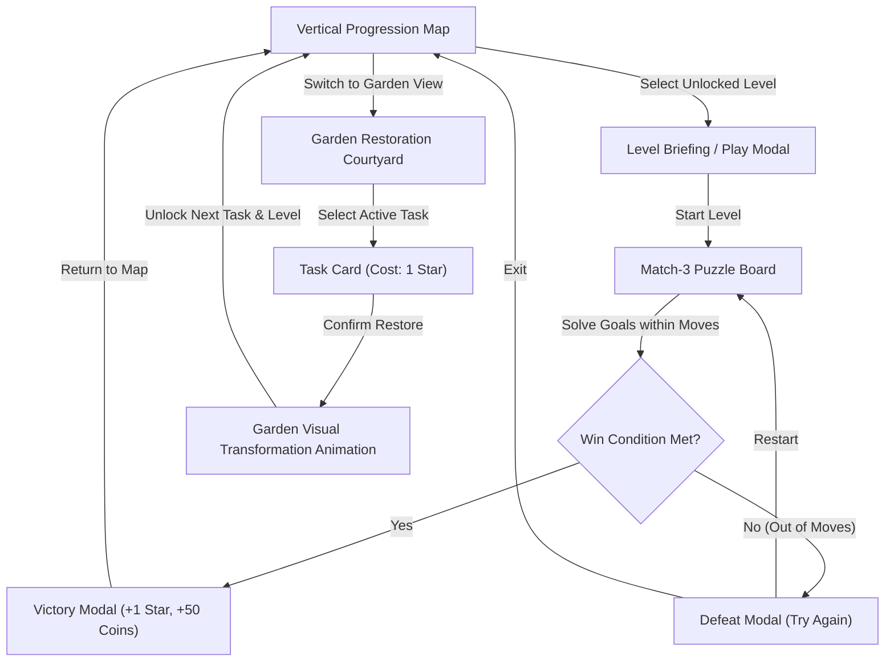

# Project Bloomtrail — Game Pillars & Product Foundation

**Document Version:** 1.0  
**Phase:** Gate 0 (Pre-Production)  
**Target Platform:** Roblox (Portrait-First Mobile, Tablet, PC)  
**Genre:** Casual Match-3 Puzzle + Garden Restoration  

---

## 1. Executive Summary

Project Bloomtrail is a warm, charming, single-player casual puzzle and garden restoration game designed specifically for the Roblox platform. Players progress exclusively by solving match-3 puzzle levels. Beating levels awards Stars and Coins, which are spent to restore, clean, and decorate an overgrown botanical courtyard. 

Progression is skill-and-puzzle driven, eliminating repetitive simulator grinding, pay-to-win barriers, and chaotic multiplayer physics.

---

## 2. Core Product Pillars

### Pillar 1: Whimsical Storybook Aesthetics
- **Tactile, Authored Visuals:** Avoid generic flat Roblox UI and default gray parts. Interfaces look like carved wood, etched stone, warm parchment, and blooming floral badges.
- **Botanical Storytelling:** An overgrown courtyard slowly breathes back to life with crystal-clear before-and-after visual contrasts.
- **Original Identity:** Distinct characters, garden lore, and puzzle elements completely differentiated from existing genre titles.

### Pillar 2: Tactile & Responsive Match-3 Gameplay
- **Crisp Feedback:** Swaps, matches, tile drops, and power-up explosions feel punchy, juicy, and physically grounded.
- **Immediate Understanding:** Tap-to-select and tap-to-swap controls feel effortless on mobile portrait viewports without demanding precise finger drag gestures.
- **Zero Input Latency Feel:** Visual predictions on the client ensure instantaneous responsiveness while server authority guarantees zero desync or reward exploitation.

### Pillar 3: Purposeful & Rewarding Progression Loop
- **Beating Levels Matters:** Every star earned is a meaningful key to advancing the garden restoration.
- **Direct Transformation:** Spending a star immediately updates the 3D garden environment (cleaning moss, clearing overgrown weeds, repairing vintage water fountains).
- **Persistent Pride:** Every restored landmark, unlocked level node, and accumulated coin balance is permanently saved to the player profile.

### Pillar 4: Fair & Respectful Difficulty
- **Deterministic Board Generation:** Initial boards never spawn with pre-matched tiles and always guarantee at least one valid legal move.
- **Fair Level Design:** Move budgets are calibrated so every level is beatable through thoughtful spatial play without forcing booster purchases.
- **No Endless Penalties:** Failure provides quick, encouraging restart options without punitive timer gates in the vertical slice.

---

## 3. Core Gameplay Loop

---

## 4. MVP Scope Boundaries

### What IS in the First Release (MVP Slice)
1. **Vertical Progression Map:** 10 hand-authored level nodes on a scrolling botanical path.
2. **Deterministic Match-3 Engine:** 8x8 grid, 5 standard fruit/nature pieces, swap validation, match-3/4/5 detection, cascade gravity, reshuffle fallback.
3. **10 Data-Driven Levels:** Introducing mechanics progressively (pure matches -> obstacles/ivy -> blossom bomb special pieces).
4. **Garden Area 1 (Courtyard Fountain):** 3 sequential restoration tasks:
   - Task 1: Clean Fountain Basin (clears vines, cleans stone).
   - Task 2: Restore Water Pipes (water fills basin and begins flowing).
   - Task 3: Plant Courtyard Flowerbeds (blooming roses and hydrangeas appear).
5. **Single-Player Server Authority:** Server validates every swap, board resolution, star grant, and task completion.
6. **DataStore Persistence:** Save profile versioning, level unlock state, currencies, and completed garden stages.
7. **Responsive Portrait UI:** Custom scale and safe-insets for phones, tablets, and PC screens.

### What is EXPLICITLY Out of Scope (Non-Goals for Gate 0 - Gate 3)
- **Monetization & Microtransactions:** No Robux purchases, coin bundles, paid booster shops, or gacha mechanics.
- **Multiplayer & Social:** No guild hubs, friend gifting, global leaderboards, or live co-op visiting.
- **Complex Cutscenes:** No voice acting, 3D animated cinematics, or branching dialogue trees.
- **Hundreds of Levels:** Focus on 10 highly polished, replayable levels rather than mass procedural level generation.
- **Third-Party Heavy Frameworks:** Pure modular Luau architecture with zero unverified external dependencies.
