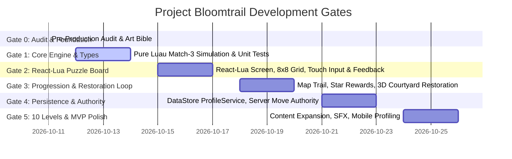

# Project Bloomtrail — Updated Implementation Roadmap & Gate Plan

**Document Version:** 2.0  
**Phase:** Gate 0 Audit & Gate 1 Planning  
**Execution Methodology:** Gate-based milestone delivery with strict empirical verification  

---

## 1. Updated Development Gate Roadmap

---

## 2. Gate-by-Gate Deliverables & Explicit Acceptance Criteria

### Gate 0: Foundation Audit & Visual Design System (CURRENT — READY FOR APPROVAL)
- **Deliverables:**
  1. `docs/AUDIT_REPORT.md`: Comprehensive audit detailing toolchain checks, Rojo synchronization safety, and 7 prioritized findings.
  2. `docs/ART_BIBLE.md` (v2.0): Full visual design tokens, typography, motion tokens, 3D lighting specs, and React-Lua component specifications.
  3. Visual Concept Mockups (`docs/concepts/`): High-fidelity mockups for World Map, Puzzle Screen, Garden Restoration, and UI Kit.
  4. Interactive Design Artifact (`index.html`): Live previewable test harness for tokens, responsive mobile portrait viewer, and component states.
  5. Updated Implementation Plan (`docs/PROJECT_PLAN.md`).
- **Explicit Acceptance Criteria:**
  - [x] All 7 pre-production planning documents audited and synchronized.
  - [x] Rojo live synchronization verified non-destructive on Studio `Workspace` and services.
  - [x] High-fidelity visual concepts produced for all 3 required screens.
  - [x] Exact design tokens, fonts, spacing, and interaction states defined.
  - [x] React-Lua integration strategy fully documented.

---

### Gate 1: Pure Luau Match-3 Simulation Engine & Unit Test Suite
- **Scope & Objectives:**
  - Build pure, headless Luau engine decoupled from Roblox `GuiObject` or 3D Instances.
  - Implement full type system: `BoardTypes.luau`, `LevelTypes.luau`, `ProfileTypes.luau`.
  - Implement swap validation, match detection (horizontal, vertical, L/T intersections), cascade gravity, deterministic refills, and automatic reshuffling.
  - Implement a runnable unit test suite covering all 15 test cases from `ACCEPTANCE_TESTS.md`.
- **Target Source Files:**
  - `src/shared/Types/BoardTypes.luau` (complete type expansions)
  - `src/shared/Types/LevelTypes.luau` (level schema types)
  - `src/shared/Types/ProfileTypes.luau` (persistence types)
  - `src/shared/Logic/BoardLogic.luau` (state machine, swap, tick)
  - `src/shared/Logic/MatchDetector.luau` (3/4/5 match & intersection algorithms)
  - `src/shared/Logic/GravityResolver.luau` (downward falling, top refill, cascade safety cap)
  - `src/server/TestRunner.server.luau` (Studio/CLI test harness)
- **Explicit Acceptance Criteria:**
  - [ ] `BoardLogic` initializes an 8x8 grid with **zero** immediate 3-in-a-row matches.
  - [ ] `FindPossibleMoves()` guarantees $\ge 1$ legal move or executes a safe, non-infinite reshuffle.
  - [ ] Swapping non-adjacent or non-matching tiles returns `valid = false` and preserves grid state.
  - [ ] 4-in-a-row matches create a `BlossomBomb` special piece at the target coordinate.
  - [ ] Cascades resolve downward gaps deterministically and terminate within a safety cap of 25 iterations.
  - [ ] All 15 unit tests in `ACCEPTANCE_TESTS.md` run and pass with 0 failures and 0 memory leaks.

---

### Gate 2: React-Lua Playable Puzzle Screen & Mobile Touch Experience
- **Scope & Objectives:**
  - Provision React-Lua (`@jsdotlua/react` and `@jsdotlua/react-roblox`).
  - Implement declarative React-Lua components for the gameplay screen: `<PuzzleScreen />`, `<HeaderHUD />`, `<MatchGrid />`, `<TileView />`, `<GoalDrawer />`, `<VictoryModal />`.
  - Implement responsive mobile portrait safe-insets and dynamic grid scaling.
  - Wire tap-to-select and tap-to-swap animations with punchy tactile feedback.
- **Target Source Files:**
  - `src/client/UI/Contexts/ThemeContext.luau`
  - `src/client/UI/Components/Puzzle/MatchGrid.luau`
  - `src/client/UI/Components/Puzzle/TileView.luau`
  - `src/client/UI/Components/Puzzle/HeaderHUD.luau`
  - `src/client/UI/Components/Puzzle/GoalDrawer.luau`
  - `src/client/UI/Components/Modals/VictoryModal.luau`
  - `src/client/Controllers/BoardController.luau`
- **Explicit Acceptance Criteria:**
  - [ ] Level 1 renders within an 8x8 carved cedar wood frame centered on mobile portrait (390 x 844).
  - [ ] Tapping a tile elevates it with a golden highlight ring; tapping an adjacent tile triggers a smooth 0.18s swap tween.
  - [ ] Making a valid match pops tiles with particle bursts and decrements remaining goals in the HUD.
  - [ ] Running out of moves triggers the Defeat Modal with "Retry" affordance.
  - [ ] Completing goals triggers the Victory Modal displaying "+1 Star" celebration.
  - [ ] Entire screen adheres 100% to design tokens in `docs/ART_BIBLE.md`.

---

### Gate 3: Progression Map & Garden Restoration Vertical Slice
- **Scope & Objectives:**
  - Implement React-Lua World Progression Map with 10 scrolling nodes.
  - Build the 3D Courtyard Garden scene in Workspace around the Fountain model.
  - Implement the Task Drawer and before-and-after garden transformation sequence.
  - Complete the core loop: Map -> Level 1 -> Win -> Garden -> Restore Fountain -> Visible Change.
- **Explicit Acceptance Criteria:**
  - [ ] Vertically scrolling map displays completed, active (pulsing), and locked nodes.
  - [ ] Winning Level 1 grants 1 Star and unlocks Level 2 on the progression map.
  - [ ] Navigating to Garden View positions the camera on the overgrown fountain.
  - [ ] Tapping "Restore Fountain Basin" (Cost: 1 Star) deducts 1 Star, triggers restoration camera tween, and transforms fountain model to clean flowing state.

---

### Gate 4: Server Authority & DataStore Persistence
- **Scope & Objectives:**
  - Implement `GameplayAuthority` to validate all swaps and objective completions server-side.
  - Implement `ProfileService` with versioned DataStore saves and `MockProfileService` for local Studio offline testing.
  - Implement rate limiting and anti-exploit protections.
- **Explicit Acceptance Criteria:**
  - [ ] Client cannot spoof star/currency awards; all grants occur authoritatively on the server.
  - [ ] Profile automatically loads on join and flushes dirty states on leave/shutdown.
  - [ ] When DataStore API is disabled in Studio, `MockProfileService` activates seamlessly with zero errors.
  - [ ] Progress persists cleanly across sessions.

---

### Gate 5: Content Expansion (10 Levels & MVP Polish)
- **Scope & Objectives:**
  - Author Levels 2 through 10 in `LevelRegistry` introducing Ivy blockers and Blossom Bombs.
  - Implement Garden Tasks 2 and 3 ("Restore Pipes", "Plant Courtyard Flowerbeds").
  - Integrate sound effects and run performance profiling on mobile emulator.
- **Explicit Acceptance Criteria:**
  - [ ] All 10 levels configured, beatable, and validated with automated regression checks.
  - [ ] Full 3-task garden transformation sequence completed.
  - [ ] Mobile portrait frame rate maintains stable 60 FPS without memory leaks.

---

## 3. High-Risk Decisions & Mitigation Ledger

| Risk Item | Likelihood | Impact | Concrete Mitigation |
|---|---|---|---|
| **React-Lua Bundling & Wally Integration** | High | Critical | Provide both a Wally package path and a standalone vendor bundle in `src/shared/Packages` so Studio testing operates with zero external build blockers. |
| **Cascade Loop Hangs** | Medium | High | Hard iteration cap of 25 in `GravityResolver.luau`. If exceeded, board forces immediate stabilization and logs warning. |
| **Transposed Coordinate Bugs** | High | High | Implement a centralized `BoardCoord.luau` helper that strictly converts between `(x, y)` 1-indexed coordinates and grid table slots. |
| **DataStore Read Failures** | Medium | Critical | Never overwrite an existing player profile with default empty data if `GetAsync` encounters an API outage. |
