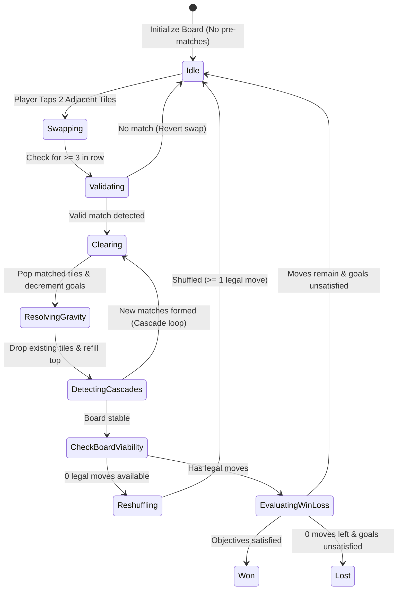

# Project Bloomtrail — Technical Architecture & Systems Specification

**Document Version:** 1.0  
**Phase:** Gate 0 (Pre-Production)  
**Language:** Luau (Roblox Strict Mode Enabled)  
**Project Format:** Rojo (`default.project.json`)  

---

## 1. Directory Structure & Module Hierarchy

Code is organized into strict logical boundaries separating pure business logic, server authority, client presentation, and configuration:

```
src/
├── shared/                             -> ReplicatedStorage.BloomtrailShared
│   ├── Types/
│   │   ├── BoardTypes.luau            -> Grid, tile, coord, and match definitions
│   │   ├── LevelTypes.luau            -> Level schema, objective definitions
│   │   └── ProfileTypes.luau          -> Player persistence schema
│   ├── Utils/
│   │   └── BoardCoord.luau            -> Cartesian (x, y) <-> Grid indexing helpers
│   ├── Config/
│   │   ├── ThemeTokens.luau           -> Centralized React-Lua design tokens
│   │   ├── GameConfig.luau            -> Timing constants, grid rules, move budgets
│   │   ├── LevelRegistry.luau         -> Registered level definitions (1-10)
│   │   └── GardenTaskRegistry.luau    -> Garden restoration tasks (1-3)
│   └── Logic/
│       ├── BoardLogic.luau            -> PURE Luau match-3 simulation (zero UI dependencies)
│       ├── MatchDetector.luau         -> Horizontal, vertical, L/T intersection algorithms
│       └── GravityResolver.luau       -> Hole handling, tile fall cascades, deterministic refills
│
├── server/                             -> ServerScriptService.BloomtrailServer
│   ├── ServerInit.server.luau         -> Server bootstrap
│   ├── Services/
│   │   ├── GameplayAuthority.luau     -> Move validation, win/loss authority, session lifecycle
│   │   ├── ProfileService.luau        -> DataStore persistence, migrations, session-locking
│   │   ├── MockProfileService.luau    -> In-memory offline profile fallback for local Studio testing
│   │   └── RewardService.luau         -> Server-only star & coin balance grants
│   └── Network/
│       └── ServerNetwork.luau         -> RemoteEvent/RemoteFunction registration & rate limiting
│
└── client/                             -> StarterPlayer.StarterPlayerScripts.BloomtrailClient
    ├── ClientInit.client.luau         -> Client bootstrap
    ├── Controllers/
    │   ├── BoardController.luau       -> Input handler (tap-to-swap), tile animation orchestrator
    │   ├── MapController.luau         -> Vertical trail scrolling, level pin interactions
    │   └── GardenController.luau      -> 3D courtyard camera tweening, restoration visual triggers
    ├── UI/
    │   ├── App.luau                   -> Declarative React root container & screen router
    │   ├── Contexts/
    │   │   └── ThemeContext.luau      -> Centralized design tokens React context
    │   └── Components/
    │       ├── Common/
    │       │   ├── PillButton.luau    -> Reusable capsule button with 3D bevel states
    │       │   └── ModalFrame.luau    -> Timber & ivory frame container
    │       ├── Map/
    │       │   ├── WorldMapView.luau  -> Scrolling progression trail
    │       │   └── LevelNode.luau     -> Medallion component (completed/active/locked)
    │       ├── Puzzle/
    │       │   ├── PuzzleScreen.luau  -> Main gameplay screen container
    │       │   ├── MatchGrid.luau     -> 8x8 Board layout
    │       │   ├── TileView.luau      -> Dual-coded tile frame with swap tween
    │       │   └── HeaderHUD.luau     -> Moves remaining, star/coin counters
    │       ├── Garden/
    │       │   └── TaskDrawer.luau    -> Restoration task card & action button
    │       └── Modals/
    │           └── VictoryModal.luau  -> Celebration popup (+1 Star)
    └── Network/
        └── ClientNetwork.luau         -> Typed network wrappers to communicate with server
```

---

## 2. Client-Server Network Contract

All gameplay actions pass through typed Remote objects located in `ReplicatedStorage.BloomtrailShared.Remotes`.

### 2.1 Remotes Ledger

| Remote Name | Type | Direction | Payload Parameters | Return Values / Response |
|---|---|---|---|---|
| `RequestStartLevel` | `RemoteFunction` | Client -> Server | `(levelId: number)` | `{ success: boolean, initialBoard: BoardState, moveLimit: number }` |
| `RequestSwap` | `RemoteFunction` | Client -> Server | `(fromCoord: Vector2int16, toCoord: Vector2int16)` | `{ valid: boolean, cascades: Array<CascadeStep>, winState: WinStatus }` |
| `RequestRestartLevel` | `RemoteFunction` | Client -> Server | `(levelId: number)` | `{ success: boolean, initialBoard: BoardState }` |
| `RequestCompleteTask` | `RemoteFunction` | Client -> Server | `(taskId: string)` | `{ success: boolean, newStarBalance: number, newStage: number }` |
| `SyncProfileData` | `RemoteEvent` | Server -> Client | `(profileData: PlayerProfile)` | Void (fires on join and balance changes) |

### 2.2 Authority & Anti-Exploit Guardrails
1. **Zero Client Trust for Game State:** The client cannot grant itself stars, declare level completion, or modify currency.
2. **Move Validation Pipeline:**
   - Server checks if a game session is active for `Player`.
   - Server verifies `fromCoord` and `toCoord` are within grid bounds and Manhattan distance `== 1` (strict orthogonal adjacency).
   - Server executes the swap in its authoritative `BoardLogic` copy.
   - If no valid match results, server rejects swap (`valid = false`); client smoothly reverts the swap animation.
   - If match is valid, server decrements moves, resolves full cascade chain, checks objectives, and updates internal session state.
3. **Rate Limiting:** Requests exceeding 10 swaps per second trigger an immediate drop to prevent spamming.

---

## 3. Pure Luau Match-3 Simulation Engine (`BoardLogic`)

`BoardLogic` is 100% decoupled from Roblox Instances (`GuiObject`, `Part`, etc.). It runs identically on server and client or in command-line unit tests.

### State Machine Lifecycle



### Deterministic Generation Rules:
- **No Initial Matches:** Random generation iterates until no 3-in-a-row pattern exists.
- **Reshuffle Guarantee:** If `FindPossibleMoves(grid)` returns 0 legal combinations, tiles are reshuffled without altering tile counts until at least 1 legal swap is confirmed.
- **Cascade Safety Cap:** While-loop cascade resolution terminates after 25 iterations to guarantee no infinite loops can crash the server.

---

## 4. Persistence & DataStore Architecture

### 4.1 Schema Definition (`ProfileTypes.luau`)

```luau
export type PlayerProfile = {
    schemaVersion: number,         -- Current: 1
    unlockedLevel: number,         -- Current highest unlocked level (Default: 1)
    stars: number,                 -- Star balance for garden tasks (Default: 0)
    coins: number,                 -- Coin balance (Default: 100)
    completedLevels: { [number]: { starsEarned: number, highscore: number } },
    gardenState: {
        currentArea: string,       -- "CourtyardFountain"
        completedTasks: { string }, -- e.g. ["task_clean_fountain"]
    },
    meta: {
        createdAt: number,
        lastSavedAt: number,
        sessionCount: number,
    }
}
```

### 4.2 DataStore Resilience & Error Policies
1. **Roblox DataStoreService vs Studio Fallback:**
   - In production / published place: Uses `DataStoreService:GetDataStore("BloomtrailPlayerData_v1")`.
   - In offline Studio (`RunService:IsStudio()` and API access disabled): Automatically routes through `MockProfileService` using an in-memory dictionary. Zero console errors or blocking crashes during local testing.
2. **Never Wipe on Read Failure:** If `GetAsync` errors due to Roblox service throttling, the session is marked `DataUnloaded` and gameplay progress is cached locally in memory with retry queues. A failed read will **never** overwrite an existing player's save with default empty data.
3. **Autosave & Shutdown Binding:** Profile saves every 5 minutes and binds to `game:BindToClose()` to flush dirty states before server termination.
