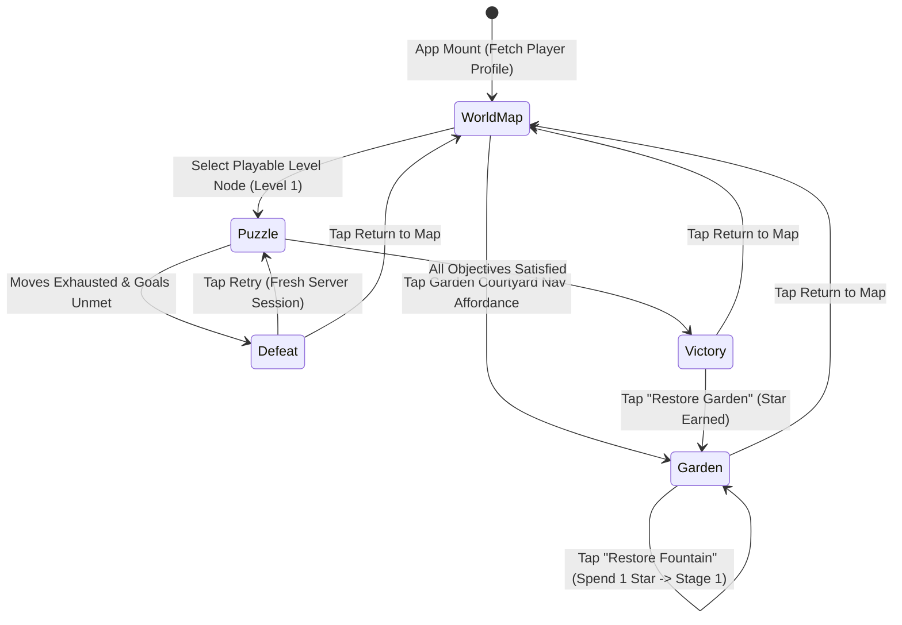

# Project Bloomtrail — Gate 3 Vertical Slice Plan & Game Loop Specification

**Document Version:** 1.0  
**Status:** Approved for Implementation  
**Milestone:** Gate 3 (First Playable End-to-End Game Loop)  
**Target Experience:** `World Map → Play Level 1 → Win or Lose → Server-Verified Rewards → Garden Restoration → Return to Map`

---

## 1. Screen & State Machine Architecture

The client application replaces the hardcoded `PuzzleScreen` root with a declarative React-Lua screen router managed in `src/client/UI/App.luau`.



### Transition Specifications
1. **`WorldMap -> Puzzle`**:
   - Trigger: Player taps an unlocked, playable level node (`Level 1`).
   - Action: Client invokes `RequestStartLevel(1)`. Server initializes or resets the authoritative `BoardSession`.
   - Router transitions to `PuzzleScreen(levelId = 1)`.
2. **`Puzzle -> Defeat`**:
   - Trigger: Engine resolves final cascade and `session.movesRemaining <= 0` while goals remain unsatisfied.
   - Action: Server marks session `"Lost"`. Client displays defeat modal with `Retry` and `Return to Map` buttons.
   - Idempotency: No stars or coins granted; profile remains untouched.
3. **`Puzzle -> Victory`**:
   - Trigger: Engine resolves final cascade and all objective goals are met.
   - Action: Server verifies win, grants one-time rewards (+1 Star, +50 Coins), unlocks Level 2, and pushes updated profile.
   - Presentation: Victory celebration modal displays "+1 Star, +50 Coins", with direct "Go to Garden" affordance.
4. **`Victory -> Garden`**:
   - Trigger: Player taps "Restore Garden" on victory card (or selects Garden from Map HUD).
   - Action: Camera smoothly tweens to the 3D Courtyard Fountain in Workspace. TaskDrawer mounts with "Restore Fountain Basin" (Cost: 1 Star).
5. **`Garden -> WorldMap`**:
   - Trigger: Player taps "Back to Map".
   - Action: Camera restores to default player view. WorldMap mounts showing Level 1 completed (with stars) and Level 2 unlocked.

---

## 2. Client-Server Network Contract & Authority

All critical state transitions are owned strictly by the server. The client renders authoritative snapshots and coordinates animations.

### 2.1 Remote Definitions (`ReplicatedStorage.BloomtrailShared.Remotes`)

| Remote Identifier | Class | Direction | Parameters | Response Payload |
|---|---|---|---|---|
| `GetPlayerProfile` | `RemoteFunction` | Client -> Server | None | `{ success: boolean, profile: PlayerProfile }` |
| `RequestStartLevel` | `RemoteFunction` | Client -> Server | `(levelId: number)` | `{ success: boolean, width: number, height: number, moveLimit: number, initialGrid: Grid, objectives: { ObjectiveState }, message: string? }` |
| `RequestSwap` | `RemoteFunction` | Client -> Server | `(fromCoord: Coord, toCoord: Coord)` | `{ valid: boolean, cascadeSteps: { CascadeStep }?, movesRemaining: number, status: GameStatus, reshuffled: boolean?, approvedProfile: PlayerProfile? }` |
| `RequestRestartLevel` | `RemoteFunction` | Client -> Server | `(levelId: number)` | `{ success: boolean, width: number, height: number, moveLimit: number, initialGrid: Grid, objectives: { ObjectiveState } }` |
| `RequestCompleteTask` | `RemoteFunction` | Client -> Server | `(taskId: string)` | `{ success: boolean, updatedProfile: PlayerProfile?, message: string? }` |
| `SyncProfileData` | `RemoteEvent` | Server -> Client | `(profile: PlayerProfile)` | Void (fires on balance change or unlock) |

### 2.2 Security & Guardrails
- **No Client Trust for Rewards:** The client never sends `ReportWin()` or `GrantReward()`. The server evaluates win state inside `RequestSwap` via `BoardLogic.evaluateWinLoss(session)`.
- **Session Isolation:** Each active player has exactly one active server session in `GameplayAuthority`. Swaps are rejected if no session exists or if the session is already completed.
- **Serialization Safety:** Engine session structures containing PRNG objects or closures are never transmitted across the network boundary. Only pure serializable tables (`Coord`, `Tile`, `CascadeStep`, `ObjectiveState`, `PlayerProfile`) are passed.
- **Rate Limiting:** Requests exceeding 10 calls per second are throttled to prevent spamming.

---

## 3. Player Profile & Reward Idempotency

### 3.1 Prototype Profile Schema (`ProfileTypes.luau`)
```luau
export type PlayerProfile = {
    schemaVersion: number,         -- 1
    unlockedLevel: number,         -- Default: 1
    stars: number,                 -- Default: 0
    coins: number,                 -- Default: 100
    completedLevels: { [string]: LevelRecord }, -- Keyed by levelId as string ("1")
    gardenState: GardenProgress,   -- { currentArea = "CourtyardFountain", completedTasks = {}, currentStage = 0 }
    meta: PlayerMeta,
}
```

### 3.2 Reward Idempotency Rule
When a player achieves victory on Level 1:
```luau
local levelKey = tostring(levelId)
if not profile.completedLevels[levelKey] then
    -- First-time completion: Grant rewards
    profile.stars += 1
    profile.coins += 50
    profile.unlockedLevel = math.max(profile.unlockedLevel, levelId + 1)
    profile.completedLevels[levelKey] = {
        starsEarned = 1,
        highscore = 1000,
        completedAt = os.time(),
    }
else
    -- Replay / Retry: Zero additional star or coin rewards
    -- Level already recorded; state preserved
end
```
Retrying or losing never deducts currency, resets progress, or grants duplicate rewards.

---

## 4. Garden Task State & 3D Restoration Stages

### 4.1 Task Definition: "Restore Fountain Basin"
- **Task ID:** `"task_restore_fountain"`
- **Display Name:** "Restore Fountain Basin"
- **Cost:** 1 Restoration Star (`stars >= 1`)
- **Area:** Courtyard Fountain (`Workspace.BloomtrailGarden.CourtyardFountain`)

### 4.2 Restoration Stages
```
Stage 0 (Initial / Overgrown):
├── Limestone basin with cracked texture & ivy overgrowth
├── Dry earthen interior
└── Restored water hidden (Transparency = 1)

Stage 1 (Restored Basin):
├── Overgrown vines dissolved / hidden (Transparency = 1)
├── Clean carved limestone rim & pedestal
└── Translucent sparkling blue water active (Transparency = 0.2, Neon / Particle spray)
```

### 4.3 Task Completion Pipeline
1. Player clicks "Restore" in `TaskDrawer`.
2. Client sends `RequestCompleteTask("task_restore_fountain")`.
3. Server validates:
   - Task ID matches registered task.
   - Task not already in `profile.gardenState.completedTasks`.
   - Player has `profile.stars >= 1`.
4. Server deducts 1 Star, appends `"task_restore_fountain"` to `completedTasks`, and increments `currentStage = 1`.
5. Server fires `SyncProfileData` and returns `{ success = true, updatedProfile = profile }`.
6. Client triggers visible 3D transformation and updates TaskDrawer to "Completed".
7. Re-clicking or resending request returns `{ success = false, message = "Task already completed" }` without deducting stars.

---

## 5. Module Ownership & Architecture

```
src/
├── shared/
│   ├── Types/
│   │   ├── BoardTypes.luau          -- Grid, Tile, Coord, CascadeStep
│   │   ├── LevelTypes.luau          -- Level definition schema
│   │   └── ProfileTypes.luau        -- PlayerProfile, GardenProgress
│   ├── Config/
│   │   ├── ThemeTokens.luau         -- Visual design tokens
│   │   ├── LevelRegistry.luau       -- Levels 1-10 definitions
│   │   └── GardenTaskRegistry.luau  -- Restoration task definitions
│   ├── Remotes/
│   │   └── RemotesInit.luau         -- Remote names & contract constants
│   └── Puzzle/
│       ├── BoardLogic.luau          -- Pure Luau simulation engine
│       ├── MatchDetector.luau       -- Line & intersection detection
│       └── GravityResolver.luau     -- Drops & deterministic refills
│
├── server/
│   ├── ServerInit.server.luau       -- Bootstrap & lifecycle
│   ├── Network/
│   │   └── ServerNetwork.luau       -- Remote registration & handler dispatch
│   └── Services/
│       ├── PlayerProfileService.luau-- In-memory profile store & idempotency
│       ├── GameplayAuthority.luau   -- Active sessions, swap validation, win checks
│       └── GardenService.luau       -- Task verification & stage transitions
│
└── client/
    ├── ClientInit.client.luau       -- UI mount & PlayerGui root
    ├── Network/
    │   └── ClientNetwork.luau       -- Typed network wrappers for Remotes
    ├── Controllers/
    │   └── GardenSceneManager.luau  -- 3D Courtyard fountain scene & camera
    └── UI/
        ├── App.luau                 -- Root router (WorldMap | Puzzle | Garden)
        └── Components/
            ├── Common/
            │   └── ResourceBadge.luau
            ├── Map/
            │   ├── WorldMapView.luau-- Scrolling 10-node trail
            │   └── LevelNode.luau   -- Completed, active, locked medallions
            ├── Garden/
            │   ├── GardenScreen.luau-- Courtyard overlay & camera hook
            │   └── TaskDrawer.luau  -- "Restore Fountain Basin" card
            └── Puzzle/
                ├── PuzzleScreen.luau-- Authoritative server-synced puzzle screen
                ├── MatchGrid.luau   -- 8x8 carved cedar grid
                ├── TileView.luau    -- Individual tile with vector silhouette
                ├── HeaderHUD.luau   -- Moves & objective counters
                └── AnimationCoordinator.luau
```

---

## 6. Testing & Acceptance Matrix

1. **Automated Pure Luau Tests (`tests/Progression.spec.luau`)**:
   - Verify initial profile default values.
   - Verify Level 1 first-time win awards 1 star, 50 coins, and unlocks Level 2.
   - Verify repeated Level 1 win awards 0 additional stars or coins (idempotency).
   - Verify loss or retry leaves profile currency unchanged.
   - Verify task completion deducts 1 star and advances stage to 1.
   - Verify task completion with 0 stars is rejected.
   - Verify duplicate task completion is rejected.
2. **Toolchain Compilation**:
   - `lune run tests/run_tests.luau` passes all engine and progression tests.
   - `rojo build default.project.json -o test_build.rbxm` compiles cleanly.
3. **Roblox Studio Integration Proof**:
   - Real Studio instance runs the full loop: Map -> Level 1 -> Win -> Garden -> Restore Fountain -> Map.
